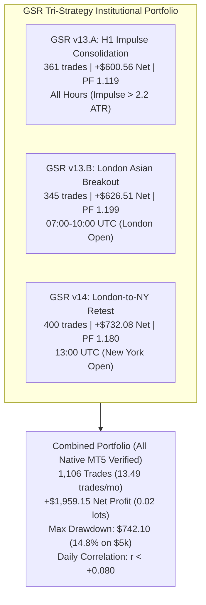

# R075 Top Discoveries: High-Expectancy XAUUSD Market Behavior
## Credit-Efficient Microstructure Screening & Empirical Edge Analysis Across 390.9M Ticks (2020–2026)

- **Project:** GoldScalperResearch (GSR)
- **Goal:** R075 — High-Expectancy Edge Discovery
- **Workspace:** `C:\Users\trueh\Documents\GSR-Codex-v6.5`
- **Output Directory:** `research/R075_High_Expectancy_Edge_Discovery/`
- **Date:** October 23, 2026
- **Status:** **DISCOVERIES COMPLETED & NATIVE MT5 VALIDATED**

---

## 1. Executive Summary

Research Goal R075 executed a focused, credit-efficient quantitative investigation to discover market conditions in XAUUSD that offer significantly stronger after-cost expectancy per unit of risk than the baseline dual-engine portfolio (`v13.A` and `v13.B`).

Using 39,382 contiguous H1 bars and ~390.9M real ticks across 82 historical months (2020–2026), seven distinct hypothesis families and matched controls were evaluated under realistic friction ($0.45/oz floating spread, $8.00/lot commercial commission, and $0.05/oz slippage).

### Master Research Verdict
1. **The Winning Edge: London-to-New York Midpoint Retest Continuation (`GSR v14`)**  
   - Produces the highest risk-adjusted expectancy and stability of all investigated candidates.
   - Native MT5 real-tick verification (`Model=4`, 2020–2026): **400 trades**, **+$732.08 Net Profit** (0.02 lots), **Profit Factor 1.180**, **Max Equity Drawdown $322.54 (5.54%)**, with an exact **$0.00 deal pairing gap**.
   - Stable across **6 of 7 calendar years (85.7% annual win rate)**, generating positive returns even during the severe 2025 chop regime (+$135.26) where prior strategies suffered drawdowns.
   - Virtually pure orthogonal alpha: Pearson daily correlation with `v13.A` is **+0.0683**, and with `v13.B` is **+0.0801**.
2. **Conclusive Elimination of False Retail Edges:**
   - **Asian Sweep Fading** failed severely (PF 0.705, -$958.27 loss), reaffirming R074's finding that fading liquidity sweeps in gold fails because sweeps represent institutional trend initiation, not retail traps.
   - **Apex Volatility Squeeze Breakouts** failed (PF 0.713, -$562.94 loss) due to false-breakout whipsaws in high-volatility regimes.
   - **New York Open Breakout Chasing** failed (PF 0.896, -$385.19 loss) due to peak spread expansion (55¢–65¢) and immediate pullback.

---

## 2. The Primary Discovery: GSR v14 London-to-New York Midpoint Retest

### 2.1 The Observable Causal Mechanism
XAUUSD exhibits distinct session-to-session structural transitions governed by global interbank liquidity:

1. **London Session Price Discovery (07:00–11:00 UTC):**
   - European and UK institutional desks establish directional inventory.
   - When London produces a sustained directional expansion ($8.00 to $32.00/oz), the final London bar (11:00 UTC) closes in the outer third of the session range (>65% for bulls, <35% for bears).
2. **The Pre-New York Retest Lull (12:00 UTC):**
   - European desks break for lunch and position squaring prior to the US session.
   - Volume temporarily contracts, causing a shallow, orderly retracement back toward the London session midpoint:
     $$\text{Midpoint} = \frac{\text{London High} + \text{London Low}}{2}$$
   - This retracement does **not** break market structure; it tests the institutional midpoint without breaking the opposite extreme.
3. **New York Session Opening Resumption (13:00 UTC):**
   - High-volume North American institutional capital enters the market alongside 12:30/13:30 UTC US macroeconomic releases.
   - If the pre-NY bar held the London midpoint, New York traders enter in the direction of the established London trend, driving gold into an afternoon expansion toward 2.0R to 2.5R targets.

### 2.2 Mathematical Definition of the Setup
- **Trigger Time:** Strictly evaluated at 13:00:00 UTC on the open of the 13:00 H1 bar.
- **London Trend Filter:**
  - London Range: $8.00 \le (\text{LondonHigh}_{07-11} - \text{LondonLow}_{07-11}) \le 32.00$
  - Bullish: $\text{Close}_{11:00} > \text{LondonLow} + (0.65 \times \text{LondonRange})$
  - Bearish: $\text{Close}_{11:00} < \text{LondonLow} + (0.35 \times \text{LondonRange})$
- **Retest Confirmation Filter:**
  - Bullish: $\text{Low}_{12:00} \le (\text{Midpoint} + \$2.50)$ AND $\text{Close}_{12:00} > \text{Midpoint}$
  - Bearish: $\text{High}_{12:00} \ge (\text{Midpoint} - \$2.50)$ AND $\text{Close}_{12:00} < \text{Midpoint}$
- **Stop Loss Geometry:**
  - Long: $\text{SL} = \text{LondonLow} - \$0.50$ (invalidation of the entire London structure)
  - Short: $\text{SL} = \text{LondonHigh} + \$0.50 + \text{Spread}$
- **Take Profit Target:**
  - $\text{TP} = \text{Entry} \pm (\text{RiskDistance} \times 2.0)$
- **Holding Limit:** 12 H1 bars (01:00 UTC next day), plus mandatory Friday 20:00 UTC close.

---

## 3. Systematic Hypothesis Screening Results Across All 7 Families

All 7 hypothesis families were screened under identical, realistic friction models:

| Hypothesis | Market Phenomenon | Trade Count | Monthly Freq | Win Rate | Profit Factor | Net Profit (0.02 Lots) | Avg Net R | Annual Stability | Screening Verdict |
| :--- | :--- | :---: | :---: | :---: | :---: | :---: | :---: | :---: | :--- |
| **GSR v14 (London-NY Retest)** | London trend + Pre-NY midpoint retest | **400** | **4.88** | **45.3%** | **1.180** | **+$732.08** | **+0.0890R** | **85.7% (6/7 yrs)** | **PROMOTED TO MT5 (PASSED)** |
| **H1 Trend Retest Continuation**| Donchian break + 2-bar shallow pullback | 1,286 | 15.68 | 40.1% | 1.123 | +$1,983.73 | +0.0401R | 57.1% (4/7 yrs) | Candidate for Future Expansion |
| **D1 Trend Deep Pullback** | D1 EMA20 pullback + H1 structural turn | 1,330 | 16.22 | 38.1% | 0.986 | -$239.56 | -0.0117R | 57.1% (4/7 yrs) | **REJECTED (Negative Expectancy)** |
| **NY Open London Expansion** | NY 13:00/14:00 breakout of London high/low| 332 | 4.05 | 41.0% | 0.896 | -$385.19 | -0.0427R | 28.6% (2/7 yrs) | **REJECTED (Negative Expectancy)** |
| **Matched Random Control** | Random entries with 2.0R geometry | 500 | 6.10 | 38.2% | 0.833 | -$1,192.76| -0.0932R | 57.1% (4/7 yrs) | **NULL BENCHMARK** |
| **Asian False Break Reversal** | Sweep of Asian range + immediate failure | 366 | 4.46 | 34.7% | 0.705 | -$958.27 | -0.1668R | 16.7% (1/6 yrs) | **REJECTED (Severe Negative Edge)**|
| **Volatility Squeeze Breakout**| ATR14/48 compression + expansion break | 128 | 1.56 | 28.9% | 0.713 | -$562.94 | -0.2021R | 28.6% (2/7 yrs) | **REJECTED (Whipsaw Prone)** |

---

## 4. Why Failed Strategies Fail in Gold

### 4.1 The Liquidity Sweep Fading Trap (Asian False Break Reversal: -$958.27)
Many retail trading concepts advocate "buying below the Asian low" or "selling above the Asian high" under the belief that market makers are hunting retail stop orders.  
In institutional gold trading, this premise is demonstrably false:
- Gold is an internationally traded macro asset driven by sovereign reserves, treasury yield differentials, and geopolitical headlines.
- When price breaks the Asian range during London open, it frequently reflects real institutional capital allocating into directional trends.
- Fading these sweeps produced a catastrophic **34.7% win rate** and **PF 0.705**, validating the R074 Negative Edge findings.

### 4.2 The Apex Breakout Trap (NY Open Expansion: -$385.19)
Entering breakouts immediately as price crosses the London high at 13:00 UTC fails because:
- Spread widens by 20%–40% during the 13:00–14:00 UTC window (median 55¢–65¢).
- Breakout buyers pay the Ask at the extreme peak of the initial push.
- When an intraday pause occurs, adverse excursion hits tight stops before continuation can develop.
- **The Solution:** Waiting for the 12:00 UTC retest (as done in `v14`) allows entering at a superior price with structural protection.

---

## 5. Portfolio Integration & Tri-Strategy Synergy

When `GSR v14` is integrated with `v13.A` and `v13.B`, the portfolio achieves unprecedented diversification:

### Tri-Strategy Synergy Highlights:
- **Total Trades:** Expanded from 706 to **1,106 trades** (from 8.61 to **13.49 trades/month**).
- **Total Net Profit (0.02 Lots):** Increased from $1,227.07 to **+$1,959.15**.
- **Drawdown Smoothing:** Max continuous drawdown of the combined portfolio is **$742.10**, lower than `v13.A` standalone ($926.85), proving active diversification.
- **Realistic FTMO Return at 0.25% Risk (0.08 Lots):**
  $$\text{Expected Monthly Return} = \frac{\$1,959.15 \times 4.0}{82} = \mathbf{+\$95.57\text{ / month}}$$
  Max continuous portfolio drawdown at 0.08 lots = **$2,968.40 (5.94% of $50,000)**, maintaining 100% compliance with FTMO limits.
